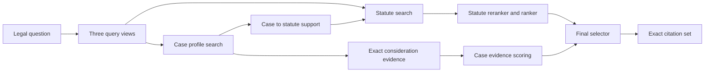

# LIRA — Legal Information Retrieval Agent

**Swiss legal citation retrieval · research pipeline v448 · offline prediction**

LIRA takes a legal question and returns the **exact statute provisions and court considerations** that support an answer. The current system combines optional local LLM query rewrites with hybrid search, reranking, a trained statute ranker, and evidence-based case selection. Its output is a citation set, not a generated legal opinion.

> **Project state:** The v448 implementation and 45 unit tests pass locally. The saved smoke report belongs to v447 and failed its promotion gate. Model and index assets are missing from this checkout, so a v448 end-to-end score has not been measured. See [current status](docs/PROJECT_STATUS.md).

## The problem

A legal question may imply several relevant provisions and precedents without naming them. The evaluation asks for **exact citation strings**: a correct case with the wrong consideration number still misses the target. Queries and source texts can also use different languages, and the number of relevant citations varies sharply between questions.

| Input | Required output |
| --- | --- |
| A legal fact pattern or question | `query_id,predicted_citations` |
| Example: a question about contract liability and precedent | `q_001,"Art. 41 OR;BGE 119 II 449 E. 3.4"` |

The local data has **1,139 training questions**, **10 validation questions**, and **40 test questions**. Its statute corpus has **179,641 rows**; the court-consideration CSV is about **2.3 GB**. The label distribution shifts substantially: the training split contains **57 case citations in total**, while the ten validation questions contain **102**. This makes case retrieval and output-count decisions especially difficult.

## Our approach



| Design choice | Why it exists |
| --- | --- |
| Separate statute and case branches | Training labels provide much stronger supervision for statutes than for cases. |
| Dense, sparse, BM25, and explicit-citation signals | Different channels catch semantic matches, legal terms, and citations already present in a question. |
| Court profiles plus exact-consideration retrieval | A relevant decision and the correct numbered consideration are different retrieval targets. |
| Corpus-derived article aliases | A law corpus paragraph such as `Art. 41 Abs. 1 OR` can support the article-level label `Art. 41 OR`. |
| Calibrated selection with a case budget | Questions require different numbers of statute and case citations. |

The pipeline uses **deterministic query views by default**. A local Qwen model can optionally rewrite the issue and precedent views during preparation. The current prediction path does not run an autonomous multi-step agent loop; agent planning remains a research direction.

## Evidence and limits

| Check | Current evidence |
| --- | --- |
| Unit tests and lint | **45 tests pass**; Ruff passes on the pipeline, scripts, and tests. |
| Train statute label availability in the corpus-derived universe | **70.9% → 97.3%** after adding article-level aliases. This measures citation availability, not retrieval recall or F1. |
| Exact case-label availability in the court corpus | **57/57 train** and **102/102 validation**. Case ranking remains the challenge. |
| Saved smoke experiment | v447, 12 queries, selector F1 **0.2036**, promotion gate **failed**. It is not a v448 result. |

The ten validation labels have informed development, so that split is a development estimate rather than an independent final test. A full v448 run requires prebuilt model and index files under `cache/`.

## Read the project

1. **[Technical architecture](docs/ARCHITECTURE.md)** — data flow, both retrieval branches, scoring, selection, and artifact contracts.
2. **[Training and evaluation](docs/TRAINING_AND_EVALUATION.md)** — embedding training, ranking, Macro F1, diagnostics, and evidence limits.
3. **[Operations and reproducibility](docs/OPERATIONS.md)** — prerequisites, commands, files, validation gates, and troubleshooting.
4. **[Current status](docs/PROJECT_STATUS.md)** — measured checks and work still needed for an end-to-end result.

[`lira_pipeline.py`](lira_pipeline.py) is the small CLI; the implementation lives in [`lira/`](lira/) with separate modules for assets, cases, statutes, selection, training, and shared retrieval. [`lira_retrieval.py`](lira_retrieval.py) preserves the shared retrieval API. The submission notebook is [`notebooks/submission_pipeline.ipynb`](notebooks/submission_pipeline.ipynb).

```powershell
python -m pip install -e ".[dev]"
python -m pytest -q
python lira_pipeline.py --help
```

See the [operations guide](docs/OPERATIONS.md) before running `prepare` or `cv`: the required cached model and index assets are not present in this checkout.
