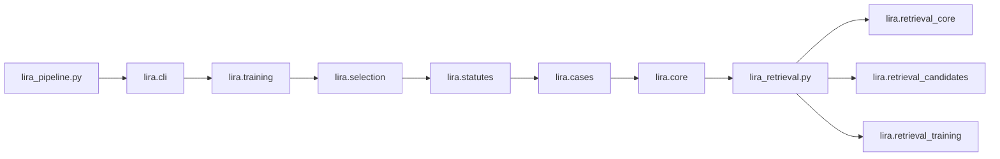
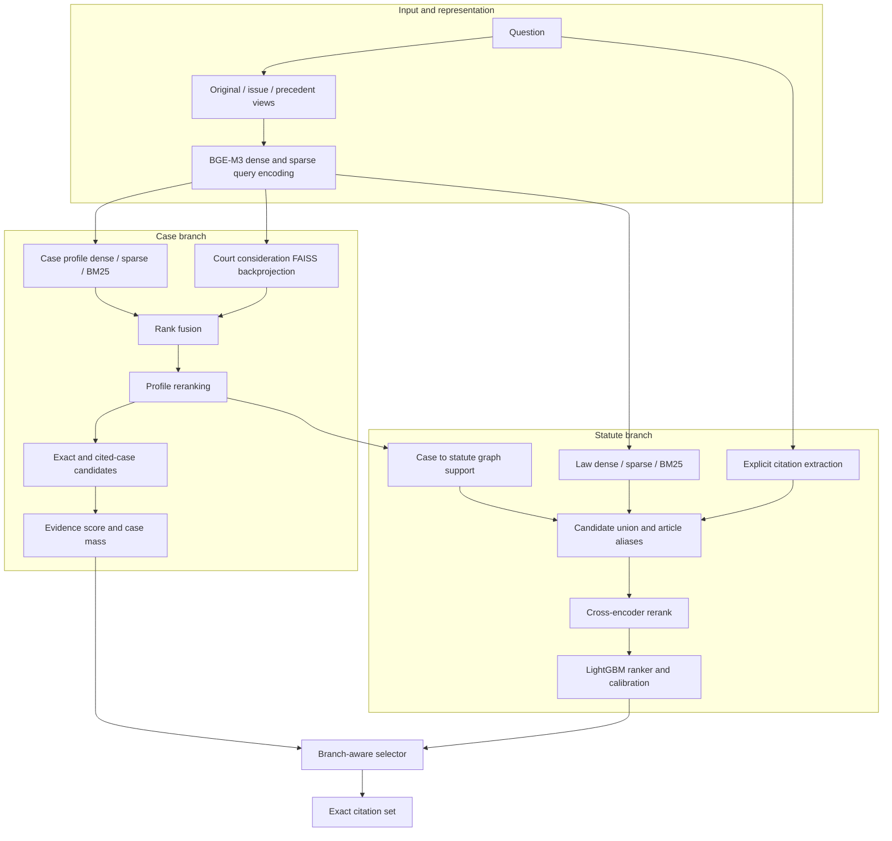
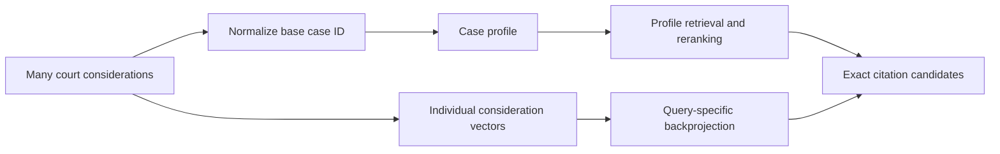
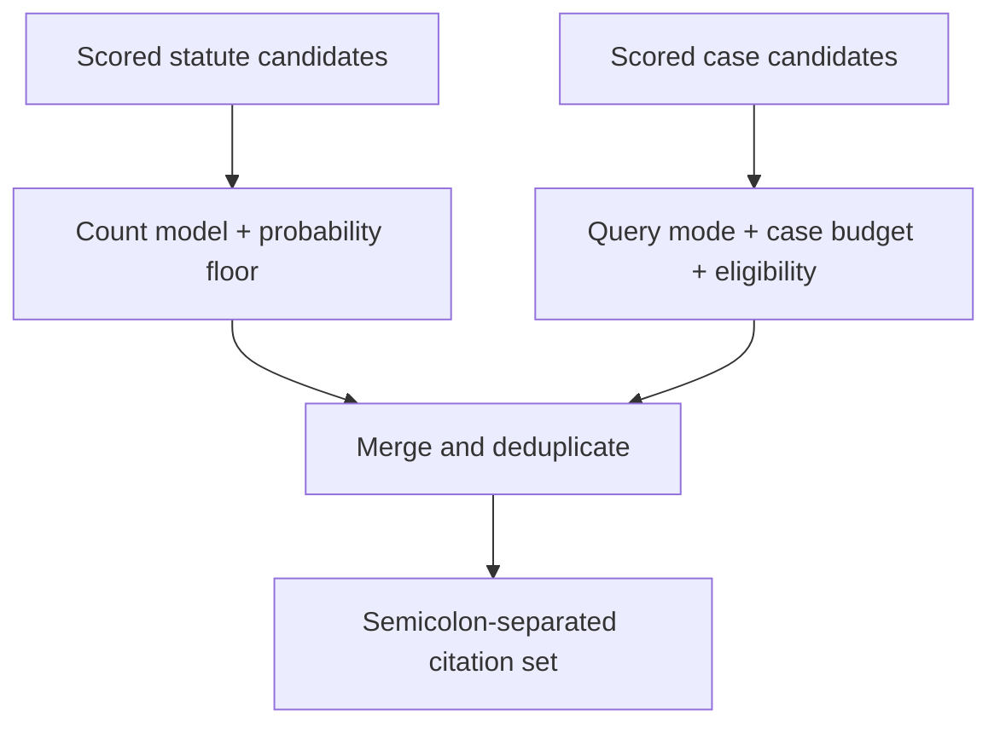

# LIRA v448 — technical architecture

**Audience:** engineers reviewing retrieval, ranking, and inference.  
**Entry point:** [`lira_pipeline.py`](../lira_pipeline.py).  
**Implementation:** [`lira/`](../lira/).  
**Shared retrieval facade:** [`lira_retrieval.py`](../lira_retrieval.py).

## 1. System boundary

LIRA maps a `query_id` and legal question to a **set of exact citation strings**. It does not generate a legal explanation. In quality mode, prediction loads a versioned model bundle and prebuilt local assets, then writes `query_id,predicted_citations` with citations separated by semicolons.

### Module map

| Module | Responsibility |
| --- | --- |
| `lira/core.py` | Configuration, artifacts, resource loading, query views, and common search helpers |
| `lira/cases.py` | Case-profile retrieval, exact-consideration evidence, scoring, and graph support |
| `lira/statutes.py` | Statute candidates, reranking, feature schema, and count features |
| `lira/selection.py` | Query mode, case budget, and final citation selection |
| `lira/training.py` | OOF generation, model fitting, diagnostics, and bundle loading |
| `lira/cli.py` | `prepare`, `cv`, `val`, and `predict` command handlers |
| `lira/retrieval_*.py` | Shared V43 normalization, indices, candidate generation, training, and CLI |

The two root Python files re-export public APIs and keep the command names. Implementation modules import the earlier stages they depend on; tests patch the owning module for controlled behavior.

### Input contracts

| File | Required fields | Use |
| --- | --- | --- |
| `data/train.csv` | `query_id`, `query`, `gold_citations` | Training and out-of-fold diagnostics |
| `data/val.csv` | Same fields | Development report |
| `data/test.csv` | `query_id`, `query` | Prediction |
| `data/laws_de.csv` | `citation`, `text`, `title` | Statute corpus and text for reranking |
| `data/court_considerations.csv` | `citation`, `text` | Court profile construction and consideration evidence |

The submission field is `predicted_citations`, a semicolon-separated string. The evaluator treats it as a set, so duplicates bring no benefit. Exact punctuation, article level, and consideration number matter.

## 2. Query representation

`deterministic_query_views` constructs three strings: the original question, an issue-focused view containing detected codes/terms/explicit citations, and a precedent-focused view of facts and terms. `encode_query_views_for_query` produces dense and sparse BGE-M3 vectors. A local Qwen model may rewrite the two derived views when `LIRA_V44_ENABLE_LOCAL_QWEN=1`; deterministic views are the fallback and the default. Views are cached by query ID before normal inference.

The encoder and reranker serve different purposes: the encoder retrieves a broad candidate set; the cross-encoder evaluates query–candidate pairs on a much smaller shortlist. The `build_late_interaction_proxy` feature combines dense and sparse evidence; it is **not a full ColBERT model**.

## 3. Case branch

### Case profiles

`iter_case_profile_feature_rows` groups court considerations under a normalized **base case ID**. Each `CaseProfile` stores exact consideration IDs, cited statutes and cases, representative snippets, and a profile text. Profile dense vectors, sparse postings, BM25, and a FAISS index are built once and cached. A base citation such as `BGE 119 II 449` and an exact citation such as `BGE 119 II 449 E. 3.4` are kept distinct.

### Retrieval and exact-citation evidence

`retrieve_case_profile_candidates` combines four channels: profile dense FAISS, profile sparse search, profile BM25, and dense search over individual court considerations. The last channel maps consideration hits back to their base cases. Its directly retrieved **exact consideration IDs** are placed before the profile's stored IDs for that query. Rank maps are fused using reciprocal rank fusion, then `rerank_case_profiles` scores the leading profiles with the cross-encoder.

With zero-based ranks and the default `rrf_k = 60`, the fusion contribution of a hit is `1 / (60 + rank + 1)`. A case retrieved by several channels therefore gains support without requiring their raw similarity scales to match. The default profile shortlist is **300**, and up to **120** profiles enter cross-encoder reranking.

`build_case_candidate_frame` gathers exact IDs from leading profiles and cases cited by them. It records source and support features, applies an initial score, and prunes to a default maximum of **120 candidates**. The v448 diversity pass first keeps up to **three candidates per base case**, then fills remaining slots by score. This avoids allowing one long decision to occupy the whole shortlist.

### Evidence score and selection

`apply_case_evidence_model` combines normalized RRF, reranker, late-interaction proxy, support, direct-hit, regex, and exact-citation signals. It then applies citation frequency/IDF weighting and a penalty to base-only citations. Scores are converted to a softmax distribution; near-tied scores use a rank-decay fallback. The resulting `case_prob` is **relative candidate mass**, not a calibrated probability of legal relevance.

The case branch has two execution modes:

| Mode | Work performed | Main use |
| --- | --- | --- |
| `support_only` | Retrieve case profiles and derive statute support; skip full case reranking/output | Statute candidate generation during training |
| `full_case` | Rerank profiles, construct exact case candidates, score case evidence | Case OOF frames, validation, prediction |

## 4. Statute branch

`build_statute_candidates` starts with explicit citations found in the question. Each query view then searches law vectors through dense similarity, learned sparse weights, and BM25. It also adds top supported statutes from the case branch. Default per-view retrieval sizes are **300 dense**, **300 sparse**, and **200 BM25**; the graph contributes up to **32** direct candidates.

The v448 article-alias path matters because the corpus often stores `Art. 41 Abs. 1 OR` while a label asks for `Art. 41 OR`. `parent_statute_citation` derives the article-level form from a paragraph-level source. The parent candidate inherits channel hits, ranks, and scores from retrieved child provisions. Labels are never used to create candidates at prediction time.

Candidates receive RRF and numeric features for dense/sparse/BM25 strength, channel and view coverage, explicit citation hits, domain match, graph support, and article-alias support. The union is capped at **1,500** by default, with explicit and top graph citations admitted first. The leading **200** are cross-encoder reranked. `get_statute_feature_columns` excludes labels and metadata from training features.

| Feature family | Examples in the candidate frame | Intended signal |
| --- | --- | --- |
| Retrieval rank and strength | `rrf_score`, `best_dense_score`, `best_sparse_score`, `best_bm25_score` | How strongly a source channel matched |
| Coverage | `channel_coverage`, `view_coverage`, per-view hit/rank fields | Agreement across methods and query views |
| Legal structure | `domain_match`, `neighbor_support`, `official_alias_hit` | Code and article-context support |
| Cross-branch evidence | `graph_case_support`, `graph_hit` | Statutes suggested by retrieved cases |
| Article-level derivation | `parent_alias_hit`, `parent_child_count` | A retrieved paragraph supports an article citation |
| Late scoring | `reranker_score`, `colbert_score` | Query–candidate text match and dense/sparse proxy |

The label, query ID, citation string, fold, raw model score, and calibrated probability are excluded from model features. The reranker is required for quality-mode training; an inactive reranker is checked before accepting a full `cv` run.

The statute model is a LightGBM LambdaMART ranker. A logistic-regression calibrator maps its raw scores to `prob`; a separate Poisson LightGBM model estimates how many statutes to emit. This branch is supervised because the training data has materially more statute labels than case labels.

## 5. Final selector

`select_predictions` estimates the statute count, classifies the query as statute-heavy, mixed, or case-heavy from candidate evidence, and computes a case budget. The default case budget is clipped to **0–25**, removing the former five-case ceiling. Statutes are sorted by calibrated `prob` before applying the floor and count. Cases must pass evidence, reranker, and support conditions. `merge_predictions` removes duplicates and suppresses a base case when an exact consideration for that case is selected.

The statute count is the count-model output multiplied by a tuned selector multiplier, rounded, and clipped to **0–40**. The case budget combines counts of strongly supported exact cases, profiles above the reranker threshold, top-case score mass, and explicit-case hits; a statute-heavy query reduces that budget. Case evidence can still veto individual candidates through minimum score and support conditions. The 25-case limit is capacity, not a promise to emit 25 cases.

## 6. Defaults worth knowing

| `V44Config` setting | Default | Effect |
| --- | ---: | --- |
| `n_splits`, `random_seed` | `5`, `42` | Cross-validation folds and deterministic split seed |
| `case_profile_faiss_factory` | `IVF2048,PQ64x8` | Approximate profile vector index |
| `case_profile_rerank_k` | `120` | Maximum profiles evaluated by the cross-encoder |
| `case_candidate_cap`, `case_diversity_per_base` | `120`, `3` | Candidate limit and first-pass base-case diversity |
| `laws_dense_k`, `laws_sparse_k`, `laws_bm25_k` | `300`, `300`, `200` | Per-view statute retrieval budgets |
| `laws_graph_k`, `laws_union_pool_cap`, `laws_rerank_k` | `32`, `1500`, `200` | Graph entry, union, and text reranking budgets |
| `statute_count_clip`, `case_count_clip` | `(0, 40)`, `(0, 25)` | Maximum final output budgets by branch |
| `dense_min_sim`, `rrf_k` | `0.18`, `60` | Dense cutoff and rank-fusion smoothing |

These are **current code defaults**, not tuned universal settings. The smoke harness changes several budgets for its CPU presets; its results must be labeled with the preset and pipeline version.

## 7. Artifacts, versions, and runtime

| Artifact family | Examples | Produced or consumed by |
| --- | --- | --- |
| Base model and corpus vectors | Fine-tuned BGE-M3; law/court dense arrays; law sparse weights | Setup scripts and `prepare` |
| Court metadata and search | `court_meta.pkl`, court FAISS | Setup and shared V43 code |
| V44 retrieval caches | Query views, case profiles, profile FAISS/sparse/BM25, law BM25 | `prepare` |
| Training caches | Out-of-fold and full-train candidate tables | `cv` |
| Final model | `cache/v44_models/model_bundle.pkl` | `cv`, then `val`/`predict` |
| Packaging manifest | `cache/v44_kaggle_manifest.json` | Asset packaging and quality-mode `predict` |

The pipeline version is `v448`; candidate tables and model bundles are checked against it. Candidate frames are saved with pipeline, cache-kind, and schema metadata using a temporary file followed by `os.replace`. A mismatched or corrupted candidate cache is discarded. `predict` expects prepared files and does not intentionally persist rebuilt indices. Quality mode validates the manifest and requires the local reranker. A reranker-disabled mode exists for diagnostics, but its predictions are a different execution path.

The main review points are `V44Config` and `load_resources` in `core.py`; `retrieve_case_profile_candidates` and `build_case_candidate_frame` in `cases.py`; `build_statute_candidates` in `statutes.py`; `select_predictions` in `selection.py`; and `run_oof_statute_training` in `training.py`.

**Next:** [Training and evaluation](TRAINING_AND_EVALUATION.md) · [Operations](OPERATIONS.md) · [Current status](PROJECT_STATUS.md)
