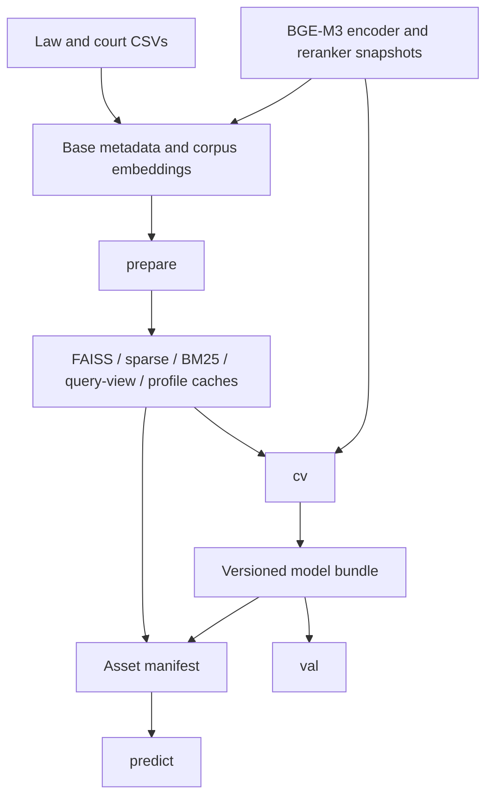

# LIRA v448 — operations and reproducibility

This runbook describes the **current code path** and its prerequisites. It is designed for a reviewer who wants to reproduce checks or prepare a new bundle. The checkout contains the input CSVs but **does not contain `cache/`**, so the full pipeline cannot currently run from a single command.

## 1. Environment

Use Python **3.10 or newer** from the repository root. The project declares FAISS, BGE-M3/FlagEmbedding, LightGBM, NumPy, pandas, scikit-learn, PyTorch, tqdm, and Transformers as runtime dependencies. Training helpers additionally use `datasets`, `psutil`, and `sentence-transformers`.

```powershell
python -m pip install -e ".[dev]"
python -m pytest -q
python -m ruff check lira_pipeline.py lira_retrieval.py scripts tests
```

For embedding fine-tuning, also install `.[training]`. GPU memory, system RAM, and disk requirements depend on the model and the 2.3 GB court corpus; the repository does not currently provide a measured clean-build resource budget.

## 2. Asset dependency graph



### Files needed before `prepare`

| Asset | Default path | Why it is needed |
| --- | --- | --- |
| Fine-tuned encoder | `cache/bge_m3_finetuned/model/` | Query and profile encoding |
| Law dense vectors | `cache/bge_m3_laws_dense.npy` | Dense statute search |
| Law sparse metadata | `cache/bge_m3_laws_sparse.pkl` | Sparse statute postings and citation order |
| Court dense vectors | `cache/bge_m3_dense.npy` | Consideration backprojection and court FAISS |
| Court metadata | `cache/court_meta.pkl` | Aligned `case_ids` and `case_citations` arrays |
| Local reranker snapshot | `cache/hf_bypass/hub/models--BAAI--bge-reranker-v2-m3/snapshots/...` or `LIRA_RERANKER_PATH` | Required by quality-mode `cv` |

`prepare` can build downstream FAISS, sparse, BM25, profile, and query-view caches **after** these base inputs exist. It cannot reconstruct every base file from the two raw corpora. The `scripts/setup/` files reflect earlier local asset workflows; inspect and test them before a fresh build. In particular, the court re-encoder rewrites an existing dense matrix in place, and the older corpus re-encoder can load a very large court CSV into memory.

The manifest generated by `package_submission_assets.py` records derived retrieval assets and the model bundle. It does not currently enumerate every base encoder, embedding array, and metadata input required by `load_resources`. An offline package must include those files as well.

## 3. Normal command sequence

Run these **only after the prerequisites above are present**:

```powershell
python lira_pipeline.py prepare
python scripts/run_smoke_evaluation.py --mode smoke
python lira_pipeline.py cv
python lira_pipeline.py val
python scripts/package_submission_assets.py --require-bundle
python lira_pipeline.py predict
```

| Command | What it does | Expected file or check |
| --- | --- | --- |
| `prepare` | Builds derived retrieval caches and runs validation diagnostics | `cache/` indices, profiles, views, and prepare gate |
| Smoke harness | Small train/tune/eval diagnostic with acceptance flags | `output/fast_v44_dev_report.json` and misses report |
| `cv` | Fits ranker and count model, tunes case evidence and selector | `cache/v44_models/model_bundle.pkl` |
| `val` | Scores the saved bundle on the ten-query development split | `output/val_v44.csv` and Macro F1 in console |
| Asset packaging | Hashes and writes an asset manifest | `cache/v44_kaggle_manifest.json` |
| `predict` | Runs offline inference on the test split | `output/submission_v44.csv` |

Use `python lira_pipeline.py cv --report-val` only when a validation report during cross-validation is specifically needed. The standalone `val` command keeps training and reporting easier to separate. The notebook [`notebooks/submission_pipeline.ipynb`](../notebooks/submission_pipeline.ipynb) assumes packaged assets are already present and writes a Kaggle-style submission in `/kaggle/working/`.

## 4. Gates and output checks

`prepare` reports statute candidate recall, statute top-50 recall, case-profile top-200 overlap, and exact-case top-50 recall. Its current acceptance thresholds are **0.95**, **0.60**, **0.80**, and **0.35**, respectively. These are engineering gates on a small development split; passing them would not prove generalization. The saved v447 smoke report failed its promotion gate. Re-run it for v448 before quoting any new performance result.

```powershell
python scripts/evaluate_submission.py output/val_v44.csv
```

For a test submission, check that `query_id` and `predicted_citations` are the only columns, every test ID appears exactly once, and no citation field contains an unintended separator or blank item. The local scorer aligns rows by ID for labeled validation; the hidden test has no local gold labels.

### Runtime configuration

| Setting | Meaning |
| --- | --- |
| `LIRA_RERANKER_PATH` | Override the local reranker snapshot path. |
| `LIRA_BGE_M3_PATH` | Override the base encoder snapshot used by the training script. |
| `LIRA_V44_RERANKER_DEVICE` | Force `cpu` or `cuda` for reranking. |
| `LIRA_V44_RERANKER_BATCH_SIZE` | Override reranker batch size. |
| `LIRA_V44_ENABLE_LOCAL_QWEN=1` | Opt into local LLM query rewrites during view construction. |
| `LIRA_V44_DISABLE_RERANKER=1` | Diagnostic fallback; changes the quality path and bypasses its manifest check. |
| `LIRA_SHOW_PROGRESS=1` | Show progress bars. |

The default query views and final inference path are offline. An optional local LLM is not required for prediction.

## 5. Troubleshooting by stage

| Symptom | Inspect first |
| --- | --- |
| Missing court matrix or metadata | Base asset paths and alignment between court CSV, `case_ids`, and embedding rows. |
| Missing law sparse postings | `bge_m3_laws_sparse.pkl` schema: ordered `citations` and `lexical_weights`. |
| Reranker unavailable | Cached snapshot or `LIRA_RERANKER_PATH`, then CPU/CUDA selection. |
| Manifest or bundle version mismatch | Regenerate caches and bundle for pipeline `v448`; do not silently reuse v447 candidate tables. |
| Low statute candidate recall | Check law universe coverage, dense/sparse/BM25 channel misses, parent aliases, graph candidates, and union cap. |
| Low exact-case recall | Check profile retrieval, court backprojection hits, exact-ID ordering, and diversity pruning. |
| Very low F1 despite recall | Compare emitted statute/case counts and the selector floors against gold counts. |
| Memory pressure | Profile/court index size, BM25 rebuild path, and batch settings; record the failing stage. |

## 6. Current reproducibility boundary

The code, unit tests, CSV inputs, and historical v447 report are present. The prepared `cache/` assets and trained v448 bundle are absent. Therefore the latest measured result is **not** an end-to-end result for this code. Once assets are restored or rebuilt, record versions, hashes, diagnostics, runtime, and final metrics together as described in [Training and evaluation](TRAINING_AND_EVALUATION.md).

**Related:** [Project overview](../README.md) · [Architecture](ARCHITECTURE.md) · [Current status](PROJECT_STATUS.md)
