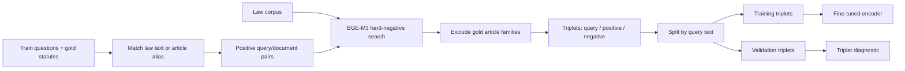
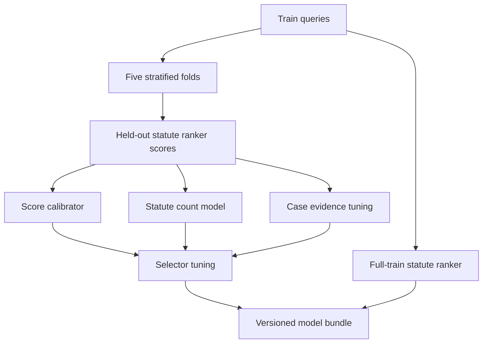
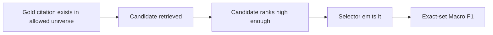

# LIRA v448 — training and evaluation

This page separates **what is trained**, **what is tuned**, and **what has actually been measured**. The current code uses labels for the statute branch and for tuning selection parameters; the case branch relies mainly on retrieval evidence because case labels are scarce in the training split.

## 1. Target and metric

Each row contains a set of exact citations. The submission is a CSV with `query_id,predicted_citations`; the citation field uses semicolons. For a predicted set $P$ and gold set $G$, the per-query score is:

$$
F_1(P,G)=\frac{2|P\cap G|}{|P|+|G|}
$$

The score is **1** when both sets are empty and **0** when exactly one is empty. Macro F1 is the arithmetic mean across queries. See [`scripts/evaluate_submission.py`](../scripts/evaluate_submission.py) for the local submission scorer and `macro_f1_from_sets` in [`lira_retrieval.py`](../lira_retrieval.py) for the pipeline metric. Both use set comparison, so exact strings and query alignment matter.

### Local split facts

| Split | Questions | Statute labels | Case labels | Role |
| --- | ---: | ---: | ---: | --- |
| Train | 1,139 | 4,602 | 57 | Model fitting and development tuning |
| Validation | 10 | 149 | 102 | Development report |
| Test | 40 | Hidden | Hidden | Submission predictions |

The case-label shift is substantial: **0.05 case citations per train question** versus **10.2 per validation question**. A selector tuned mostly on train can therefore under-emit cases on a case-rich split. The former five-case output cap could emit at most **43 of the 102** validation case labels even with perfect retrieval; v448 raises the cap to 25. This removes a ceiling, but a larger budget can also reduce precision.

## 2. Embedding model training

[`scripts/setup/train_embedding_model.py`](../scripts/setup/train_embedding_model.py) builds query–statute-text positives from training labels. It can map a gold article-level citation to a paragraph text when the corpus lacks the exact article row. It mines hard negatives from BGE-M3 retrieval, excluding both gold articles and their paragraph siblings. Mining is cached per unique query rather than repeated for every positive pair.

The triplet split is **query-disjoint**: all pairs for one query stay on the same side. The triplet diagnostic measures the embedding training task, not end-to-end legal citation F1. The script has not been rerun in this checkout; its base BGE-M3 weights and generated cache are absent. The setup scripts still encode older local assumptions and need a controlled rebuild before claiming reproducibility.

## 3. Statute ranking and count prediction

The normal `cv` path uses five stratified folds by default. Fold labels combine total citation-count buckets with whether a question has case labels when strata are sufficiently populated. In each fold, candidate generation yields numeric signals; a LightGBM LambdaMART ranker is fit on the other folds and scores held-out candidates.

After the ranker pass:

1. A logistic-regression calibrator maps raw ranker scores to a statute `prob` value.
2. A Poisson LightGBM model predicts the statute count from per-query score summaries.
3. A final statute ranker is fit on all training candidates for the saved bundle.
4. Case evidence weights and the final selector are tuned on the constructed training frames.

**Interpretation of “OOF”:** the ranker scores are out of fold. The calibrator, count model, case evidence parameters, and selector use the full set of those scores for development. The reported OOF Macro F1 is therefore a **development estimate**, not an untouched holdout score. `cv` does not report validation by default; `--report-val` makes that report explicit, and `val` runs it separately from the saved bundle.

## 4. A retrieval-to-score diagnostic ladder

These checks answer different questions and should not be quoted as interchangeable results:

| Diagnostic | Question answered | Example failure |
| --- | --- | --- |
| Universe coverage | Could the system represent the exact gold string? | Paragraph text exists but the gold article form is missing. |
| Candidate recall | Did any retrieval channel propose it? | The law or case never enters the union. |
| Top-k recall | Did it survive shortlist pruning? | A relevant case is crowded out by many considerations of another case. |
| Emission counts | Did the selector choose a suitable number? | Relevant cases are retrieved but the case budget is too small. |
| Macro F1 | How good is the final exact citation set? | Extra citations lower precision despite better recall. |

For v448, article aliases raise **train gold statute universe coverage from 70.9% to 97.3%**; validation statute coverage was already 100%. The 2.3 GB court corpus contained all **57 train** and **102 validation** exact case labels in the local audit. These are *availability* checks, not measured retrieval or final-score gains.

## 5. Current evidence and measurement limits

The only saved smoke report (`output/fast_v44_dev_report.json`) belongs to **v447**. It used a 12-query CPU smoke configuration and recorded selector F1 **0.2036**, statute candidate recall **0.5963**, statute top-50 recall **0.2370**, and `promote_to_full_cv: false`. It must not be presented as a v448 result.

The active v448 code has **45 passing tests** and clean Ruff checks. Its full F1, runtime, and memory footprint are **unmeasured** because `cache/` is absent. The ten-query validation labels have already informed design decisions, so a later score on that split should be described as a development result. A new independent holdout or external evaluation is needed for an unbiased performance claim.

## 6. Recommended full-run report

After restoring or rebuilding assets, record these together:

| Stage | Required report |
| --- | --- |
| Preparation | Corpus and artifact versions; statute candidate/top-50 recall; case profile/exact recall; memory and elapsed time |
| Smoke | Train/tune/eval sizes, acceptance gates, selection counts, misses by channel |
| Cross-validation | Fold balance, ranker/case/selector development F1, emitted counts, runtime by stage |
| Validation | Exact-set Macro F1, statute and case recall/precision, per-query errors, versioned bundle hash |
| Prediction | Manifest verification, row/ID validation, deterministic output file |

**Related:** [Architecture](ARCHITECTURE.md) · [Operations](OPERATIONS.md) · [Current status](PROJECT_STATUS.md)
